# 中豆黑体 Zhongdou Sans

[官方网站](https://otakutyrant.github.io/Zhongdou-Sans/)・[下载字体](https://github.com/otakutyrant/Zhongdou-Sans/releases/latest)

<picture>
  <source media="(prefers-color-scheme: dark)" srcset="./images/demo.png">
  
</picture>

分生自[煮豆黑体](https://github.com/Buernia/Zhudou-Sans)，后者三年无更新。原字体衍生自
[Noto Sans](https://github.com/googlefonts/noto-fonts)
和[思源黑体](https://github.com/adobe-fonts/source-han-sans)，支持中日韩标点及一些特殊符号。标点造型主要来源于 Noto
Sans，可以为类似风格的西文字体带来更加协调的中外文混排效果。

中豆黑体为可变字体，支持字重无级变化，同时提供对应思源黑体7个字重的静态版本。

中豆黑体的特色在于，区域（locl）为 zh-cn 时，华语标点符号依然一律按 zh-tw 处理即居中，以满足我汉字美学追求。民国初胡适等人推广的标点符号本来也一度贯彻这美学，可惜后来陆规不懂这些，生搬硬套符合基线美学的西文标点符号。后者特征是大多标点符号居左下且不方正，抛弃了形似古代说文解字唯二符号之钩识号的直角引号，改用边角对齐的西式弯引号；引进了俄语的书名号。

中豆黑体以更纱黑体为优先混排对象，目前以 Sarasa Fixed
SC 验证标点与正文的对齐效果；不保证与所有中西文字体都能达到相同的视觉对齐。

水平排版度量采用更纱的数值：每 em 为 1000 单位，`OS/2`
的排版升部、降部、行间隙分别为 965、−285、0，`hhea`
对应数值为 965、−215、70。这是明确的配对设计选择，不是对常见字体取平均，也不代表已有适用于所有字体的「平衡度量」。行距、基线和字形的视觉中心并非同一回事；与其他字体混排时，仍应检查实际效果。

中豆黑体是标点补充字体，不是通用等宽字体。系统配置宜将它用于 `sans-serif`
的标点回退，不宜抢占 `monospace`
的主字体位置，否则终端可能据此计算出不合适的字格宽度。文本编辑器若用于散文，可选择通用 Sans；代码编辑器与终端则保留完整的等宽主字体。

中豆黑体的名字意外地有一彩蛋：豆刚好与「读」谐音，后者有一古义，即逗号。

## 方正中宫气连美学

我可以让人智搬来一大群古代书法家帮我背书：

> 四面停勻，八邊具備，短長合度，粗細折中。心眼准程，疏密欹正。⸺傳・歐陽詢〔八訣〕

> 九宮：八面點畫皆拱中心。⸺元・陳繹曾〔翰林要訣・第九方法〕

> 凡字無論疏密斜正，必有精神挽結之處，是為字之中宮。⸺清・包世臣〔藝舟雙楫・述書〕

> 每三行相並至九字，又為大九宮，其中一字即為中宮，必須統攝上下四旁之八字，而八字皆有拱揖朝向之勢。⸺清・包世臣〔藝舟雙楫・述書〕

> 字之體勢，一筆而成，偶有不連，而血脈不斷。⸺唐・張懷瓘〔書斷〕

> 上下連延，左右顧矚，八面四方，有如佈陣。⸺明・解縉〔春雨雜述〕

汉字天生方正，点画布于九宫，四面停匀。陈绎曾所谓「八面点画皆拱中心」，道破了方块字的向心结构。不过这「中心」并非几何正中⸺〔翰林要诀〕旧注特意申明「中心者，非以一笔为中心也」；包世臣也说中宫是「精神挽结之处」，有在实画、有在虚白；刘熙载更说主笔或在字心、或在四维四正，是谓「活中宫」。中宫说的是重心，不是圆心。

但正因如此，居中标点反而更站得住：一个字的点画无论疏密斜正，都向格内收拢挽结，视觉重心总在格中一带。居左下的点号却落在八面点画所拱的结构之外，挂在字与字之间的虚白边上，重心外逸。唯有居中的点号方正饱满、与字同格，分享汉字的向心结构，而非游离其外。

汉字排版讲究行气。张怀瓘论草书一笔书，「偶有不连，而血脉不断」；解缙论一篇章法，「上下连延，左右顾瞩」；〔八诀〕同段所谓「东映西带，气宇融和」，说的也是这种字际承接。行气贵在承接，而非排成直线⸺包世臣恰恰讥笑过「上下直如贯珠，而势不相承」的字。所以他把中宫从单字推到字际：三行九字之间，亦有统摄四旁、拱揖朝向的「大中宫」。无论横排竖排，阅读视线都沿字心连线移动。居中标点守在这条视线上，前后承接，气脉不断；居角标点则把视线往格角拽，造成错位与塌陷。标点符号的出现是为了断句，但在视觉上，它不该截断气流。

## 基线美学

西方文字多为表音文字，词长不定，空格就是断词用的点号。〔汉字与中华文化十讲〕也说英文是一维文字，汉字是二维文字。华语人可试想小时候练习拉丁字母书写时，用的练习稿是不是有四条线？拉丁字母的主体和大多标点符号稳稳立在从上往下数的第三条线即基线上，随便倾斜或加粗，词长可长可短，也可以在连字上玩出花样来，反正有空格和四线兜底。在和练习华文书写的田字格字帖完全不一样，没人想在一个格子里让汉字倾斜、缩到一角、出格、连字吧。所以说在华文里混用陆规西式标点符号，就好比在田字格字帖书写英文，或是在四线纸书写华文，不伦不类。我很早就对「中文斜体」和陆规引进的西式标点符号嗤之以鼻了，把基线美学套到汉字上，没啥意义。

## 大挪移

凡是利好我美学且不符合陆规的标点符号，皆为我所用。

- 间隔号不用又窄又小的·（`U+00B7` MIDDLE DOT），用方正且较满格的・（`U+30FB`
  KATAKANA MIDDLE
  DOT）。有人嫌它是日文符号并不用，我没这禁忌。华语就引进了一大堆和制汉语词，本文所用的「符号」一词就是。
- 用六角符号即龟甲括〔〕代替书名号《》。龟甲括因形似龟甲六边而得名，方正饱满，像两片合拢的甲骨；书名号来自俄语，我总觉得和汉字不搭。
- 一律用直角引号代替西式弯引号。
- 破折号用真正的单码位双宽字符⸺（`U+2E3A` TWO-EM
  DASH），代替由两个单码位单宽字符组成的破折号——。煮豆黑体竟然也收录了这个，它没有在文档提到这点。
- 无论是陆规还是台规，省略号或删节号都由两个省略号（…，`U+2026`
  Ellipsi）组成，这就尴尬了，因为机器很难判断这个到底是该居中的华文符号，还是该居底的符号。于是哪怕用中豆黑体，访问英语网站，其优先级可能会被排在该网站指定的英语字体后面，结果哪怕在该网站输入华文，省略号会被渲染成其网站指定英语字体且居底。有个绝对居中的⋯（`U+22EF`
  MIDLINE HORIZONTAL
  ELLIPSIS），虽说是数学符号，但 Unicode 官方也承认了[东亚用它作为居中符号的排版现象](https://github.com/w3c/clreq/issues/432)：「U+22EF
  MIDLINE HORIZONTAL ELLIPSIS has also become popular for the midline ellipsis
  in East Asian typography」。中豆黑体姑且收录之。

## 与煮豆黑体的差异

中豆黑体保留原字体的字形设计，但调整了以下默认排版行为：

- 将弯引号 `‘’“”`
  的半角字形直接设为 Unicode 字符映射（`cmap`）中的默认字形，不借用任何 OpenType 功能。
- 陆规（`ZHS`）与默认语言在 `locl`
  中复用台规（`ZHT`）的居中标点查找，使未标注中文语言的编辑器也默认使用居中标点；`vert`
  则在竖排中保留居中形式。
- 对居中点号作光学校正，并将龟甲括与直角引号的墨迹在全部字重中移到全角字身的横向中心；由其构成的闭括号和竖排字形会同步归中，字身宽度保持不变。
- 只保留服务于上述目标的 `locl` 与 `vert`
  两项 OpenType 功能；移除继承自煮豆黑体的连字、宽度变体、样式集和标点挤压等无关功能。
- 已修正[行高问题](https://github.com/Buernia/Zhudou-Sans/issues/7)，并使水平排版度量与更纱黑体兼容，避免 Pango/GTK 在字体回退时错开标点与正文的基线。
- 移除与标点补充定位无关的全角拉丁字母、全角数字、许可图标和传统吉祥图案。
- 此外如上文所述，增加了一些标点符号。

### 与其他华文字体的混排评估

以 Chromium 按 `zh-CN` 排版，在常规字重下测试了更纱黑体、Noto Sans CJK
SC、思源黑体、霞鹜文楷、文泉驿正黑和 Noto Serif CJK
SC。测试中的红色标点来自中豆黑体，白色汉字来自各搭配字体；[32 像素对照图](./images/assessment/alignment-32px.png)用于观察常见阅读字号，[64 像素对照图](./images/assessment/alignment-64px.png)用于放大观察细微差异。

下表的「墨迹中心差」比较中豆直角引号与六角括号组合和示例汉字组合的轮廓包围盒中心；正值表示中豆标点较高，负值表示较低。它不是基线偏移，而且会随所选汉字而变化。

| 搭配字体                        | 32 像素墨迹中心差 | 64 像素墨迹中心差 | 混排行框〔32／64 像素〕 |
| ------------------------------- | ----------------: | ----------------: | ----------------------: |
| Sarasa Fixed SC                 |        −0.05 像素 |        −0.10 像素 |             40／80 像素 |
| Noto Sans CJK SC                |        −0.03 像素 |        −0.06 像素 |             46／92 像素 |
| Source Han Sans SC〔思源黑体〕  |        −0.05 像素 |        −0.10 像素 |             46／92 像素 |
| LXGW WenKai〔霞鹜文楷〕         |       ＋0.74 像素 |       ＋1.47 像素 |             40／80 像素 |
| WenQuanYi Zen Hei〔文泉驿正黑〕 |       ＋1.00 像素 |       ＋2.01 像素 |             44／87 像素 |
| Noto Serif CJK SC               |        −0.09 像素 |        −0.17 像素 |             46／92 像素 |

结果表明，中豆黑体与 Sarasa Fixed
SC 的基线和正常行框完全一致；在 64 像素下，所测轮廓中心仅差约 0.10 像素。Noto
Sans CJK
SC 与思源黑体来自同一套合作设计，不能视为两个独立的字形样本；它们和 Noto Serif
CJK
SC 的墨迹中心也很接近中豆标点，但较高的自身度量会使混排行框增高，而不会使字形脱离共同基线。霞鹜文楷和文泉驿正黑的视觉中心较低，差异在放大字号下较明显，在 32 像素下分别约为 0.74 和 1.00 像素。此次评估只说明这些代表性字体及所测字样的表现，不能推及所有华文字体。

<picture>
  <source media="(prefers-color-scheme: dark)" srcset="./images/Title.dark.svg">
  <source media="(prefers-color-scheme: light)" srcset="./images/Title.light.svg">
  
</picture>

> 样张文本选自马王堆汉墓帛书〔老子〕甲本、[〔请颁行新式标点符号议案（修正案）〕](https://zh.wikisource.org/wiki/%E8%AB%8B%E9%A0%92%E8%A1%8C%E6%96%B0%E5%BC%8F%E6%A8%99%E9%BB%9E%E7%AC%A6%E8%99%9F%E8%AD%B0%E6%A1%88%EF%BC%88%E4%BF%AE%E6%AD%A3%E6%A1%88%EF%BC%89)、1951年[〔标点符号用法〕](<https://zh.wikisource.org/wiki/%E6%A8%99%E9%BB%9E%E7%AC%A6%E8%99%9F%E7%94%A8%E6%B3%95_(1951%E5%B9%B4)>)和日文维基百科条目[〔約物〕](https://ja.wikipedia.org/w/index.php?title=%E7%B4%84%E7%89%A9&oldid=86255058)
>
> 样张使用的中日文字体为思源黑体

## 字符支持

- 华语、韩语、日语的现代标点符号大多通用，中豆黑体一并保留，包括间隔号・、直角引号「」、单码位双字宽字符破折号⸺和六角括号〔〕；此外还收录日语假名双连字符゠（`U+30A0`
  KATAKANA-HIRAGANA DOUBLE HYPHEN）。
- ⋯（`U+22EF` MIDLINE HORIZONTAL
  ELLIPSIS），单码位单字宽（full-width），可以作为华语省略号使用，虽然这违背了其数学语义。
- 古汉语钩识号（𖿢，`U+16FE2`）和重文号（𖿣，`U+16FE3`）

中豆黑体收录日韩会使用的标点，并不表示它们在日语（`JAN`）或韩语（`KOR`）的
`locl`
下已经全部居中。目前这两种语言只有`！`、`：`、`；`、`？`采用居中字形，`、`、`。`以及`，`、`．`仍保留偏靠字格角落的形式；不依赖
`locl`
的`・`、`゠`、直角引号和龟甲括号则沿用字体自身的方正居中造型。中豆黑体目前首先服务于华语排版；将来若有日语或韩语使用者也需要这套居中美学，可以再调整相应的地区字形。

⚠**注意：中豆黑体不包含汉字、假名、谚文、一般西文和数字，请和其他字体搭配使用。**

中豆黑体只保留两项 OpenType 功能：`locl`
使陆规（`ZHS`）及未声明地区的文本采用居中标点，`vert`
提供相应的竖排形式。其他地区仍采用各自的地区与竖排字形。

中豆黑体亦支持 Unicode 变体选择符。在相应字符后输入 VS01（`U+FE00`）或 VS02（`U+FE01`），可明确选择偏靠或居中的标点字形：

| 字符          | 顿号`U+3001` | 句号`U+3002` | 叹号`U+FF01` | 逗号`U+FF0C` | 句点`U+FF0E` | 冒号`U+FF1A` | 分号`U+FF1B` | 问号`U+FF1F` |
| ------------- | ------------ | ------------ | ------------ | ------------ | ------------ | ------------ | ------------ | ------------ |
| VS01 `U+FE00` | 、︀（偏靠）   | 。︀（偏靠）   | ！︀（偏靠）   | ，︀（偏靠）   | ．︀（偏靠）   | ：︀（偏靠）   | ；︀（偏靠）   | ？︀（偏靠）   |
| VS02 `U+FE01` | 、︁（居中）   | 。︁（居中）   | ！︁（居中）   | ，︁（居中）   | ．︁（居中）   | ：︁（居中）   | ；︁（居中）   | ？︁（居中）   |

上表中的符号可直接复制粘贴使用。

## 生成样张

README 首页样张和文内标题图的排版源码位于 [`demo/`](./demo/)，输出为
[`images/demo.png`](./images/demo.png)、[`images/Title.light.svg`](./images/Title.light.svg)和[`images/Title.dark.svg`](./images/Title.dark.svg)。在项目根目录运行：

```nu
nix develop -c nur demo preview # 构建字体并在浏览器中打开 HTML 样张
nix develop -c nur demo render  # 重新生成全部样张图片
nix develop -c nur title render # 仅重新生成浅色与深色标题图
nix develop -c nur check        # 运行字体、网页、代码与样张的完整验证
```

这些任务会先从原始字体生成中豆黑体；首页样张采用固定的 2560×1440 画布，标题图则把构建后的字体嵌入 SVG，因而不依赖读者本机安装中豆黑体。Nix
flake 锁定 Nur、渲染工具和备用字体的版本。`nur specimens check` 会在 `build/`
中另行渲染并比较结果，不改动已跟踪文件。拉取请求会运行完整的 `nur check`；推送到
`main` 后，持续集成则会在样张变化时自动创建 `docs: update generated specimens`
提交，不变时不会提交。

独立的[官方网站](https://otakutyrant.github.io/Zhongdou-Sans/)源码位于
[`site/`](./site/)。`nix develop -c nur site build`
会从页面实际出现的字符生成中豆黑体与更纱黑体 SC 的 WOFF2 子集；推送到 `main`
后，GitHub Pages 工作流会构建并发布网站。使用 `nix develop -c nur site preview`
可以在本机预览；使用 `nix develop -c nur panoptor start`
可以在后台启动同时运行网站与快速检查监听器的 Panoptor 会话，需要观察或控制各进程时再运行
`nix develop -c nur panoptor attach` 连接 Process Compose TUI。

## 授权信息

中豆黑体以〔SIL 开源字体许可证〕1.1版（SIL Open Font License
1.1，OFL）授权，可以自由使用（包括商用）、传播、修改，但不能单独出售字体文件。除非获得相应著作权人的明确书面许可，修改版本不得以保留名称「Zhongdou」或「中豆」作为向用户呈现的字体名称。字体及其修改版本须继续依〔OFL〕授权；使用字体制作的文档不受此授权要求约束。详细条款请参见
[LICENSE](./LICENSE) 及 https://openfontlicense.org/ 。
